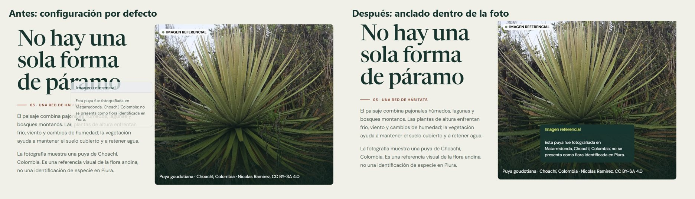
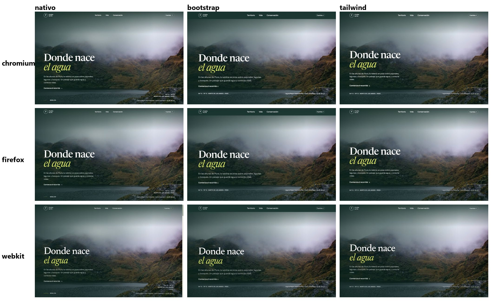
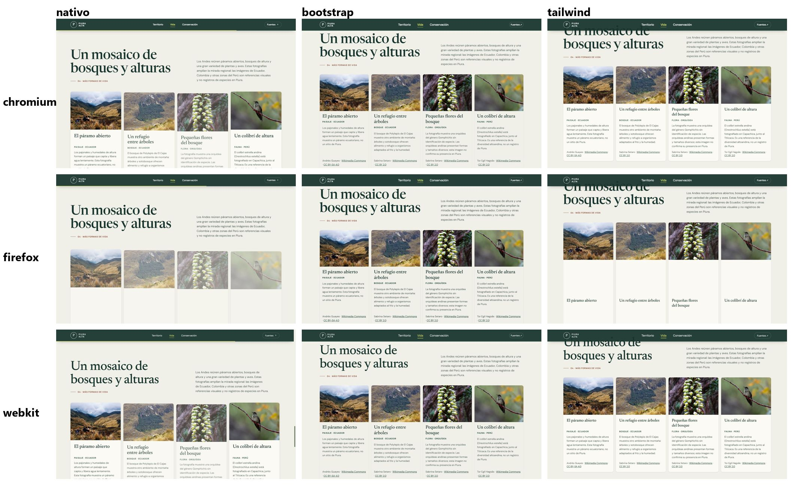

# Informe comparativo: CSS nativo, Bootstrap y Tailwind CSS

**Proyecto:** Páramos de Piura — *Donde nace el agua*
**Curso:** CSS Avanzado
**Versiones comparadas:** CSS nativo (raíz del repositorio), Bootstrap 5.3.9 (`/bootstrap`) y Tailwind CSS 4.3.5 (`/tailwind`)

---

## 1. Objetivo

Implementar el mismo sitio de tres páginas (`index.html`, `biodiversidad.html` y `conservacion.html`) con tres enfoques distintos para contrastar cómo influye cada herramienta en el código, el rendimiento, la personalización y el mantenimiento.

Las tres versiones comparten **el mismo contenido, las mismas fotografías, la misma paleta y la misma tipografía** (Newsreader, Manrope y DM Sans). Así, las diferencias que se miden se deben a la herramienta y no al diseño.

## 2. Estructura del repositorio

```
Project_CSS_Avanzado/
├── index.html, biodiversidad.html, conservacion.html   ← versión CSS nativo
├── css/                 tokens, base, layout, components, pages, animations
├── js/menu.js           cierre opcional del menú móvil
├── bootstrap/
│   ├── index.html, biodiversidad.html, conservacion.html
│   ├── css/paramos.css  personalización sobre Bootstrap
│   └── js/paramos.js    configuración de popovers y del menú
├── tailwind/
│   ├── index.html, biodiversidad.html, conservacion.html
│   ├── src/input.css    tokens (@theme) y utilidades propias (@utility)
│   ├── dist/styles.css  CSS compilado que usan las páginas
│   ├── js/menu.js       cierre opcional del menú móvil
│   └── package.json     scripts de compilación
├── less/ y scss/        registro de la entrega anterior (sin cambios)
└── docs/
    ├── informe-comparativo.md, .docx y .pdf
    └── img/             capturas usadas en el informe
```

Se eligió **un solo repositorio con una carpeta por versión** por tres razones:

- Conserva el historial completo de la evolución del proyecto, como pidió el docente.
- Facilita comparar los mismos archivos lado a lado.
- Permite publicar las tres versiones juntas en GitHub Pages.

El pie de página de cada versión enlaza a la misma página en las otras dos.

## 3. Cómo ejecutar cada versión

| Versión | Requisitos | Cómo verla |
|---|---|---|
| CSS nativo | Ninguno | Abrir `index.html` o servir la carpeta con cualquier servidor estático |
| Bootstrap | Conexión a internet (CDN de jsDelivr) | Abrir `bootstrap/index.html` |
| Tailwind CSS | Node.js solo para recompilar | Abrir `tailwind/index.html`. Para regenerar el CSS: `cd tailwind`, `npm install` y `npm run build` (o `npm run dev` mientras se edita) |

El archivo `tailwind/dist/styles.css` ya compilado se incluye en el repositorio, así que la versión Tailwind se puede ver sin instalar nada.

## 4. Métricas medidas

Las mediciones se tomaron sobre los archivos del repositorio y sobre las páginas servidas en local con Chromium. Los tamaños con *gzip* se calcularon con nivel de compresión 9.

### 4.1 Peso de los recursos

| Recurso | CSS nativo | Bootstrap | Tailwind CSS |
|---|---|---|---|
| CSS del framework | — | 232,4 KB (31,0 KB gzip) | — |
| CSS propio del proyecto | 57,6 KB (11,9 KB gzip) | 8,5 KB (2,9 KB gzip) | 41,2 KB compilado (8,6 KB gzip) |
| **CSS total enviado** | **57,6 KB (11,9 KB gzip)** | **240,9 KB (33,9 KB gzip)** | **41,2 KB (8,6 KB gzip)** |
| JavaScript | 0,5 KB (0,3 KB gzip), opcional | 81,8 KB (24,6 KB gzip) | 0,5 KB (0,3 KB gzip), opcional |
| Archivos CSS/JS por página | 6 CSS + 1 JS | 2 CSS + 2 JS | 1 CSS + 1 JS |
| HTML de las 3 páginas | 60,7 KB | 82,3 KB | 86,7 KB |

### 4.2 Aprovechamiento del CSS

Porcentaje de reglas CSS cargadas que coinciden con algún elemento de las tres páginas:

| | CSS nativo | Bootstrap | Tailwind CSS |
|---|---|---|---|
| Reglas cargadas | 303 | 2.526 | 479 |
| Reglas usadas | 297 | 293 | 462 |
| **Aprovechamiento** | **98 %** | **11,6 %** | **96,5 %** |

Bootstrap envía la librería completa: casi **9 de cada 10 reglas no se usan** en este sitio. Tailwind solo genera las utilidades que encuentra en los HTML, así que su CSS crece con el proyecto y no con la librería. El nativo solo contiene lo que se escribió.

El JavaScript del nativo y de Tailwind es opcional (*mejora progresiva*): el menú móvil se abre y se cierra solo con CSS, y el script únicamente lo cierra al elegir una sección de la misma página (ver la sección 6.6).

### 4.3 Esfuerzo de escritura y legibilidad del HTML

| | CSS nativo | Bootstrap | Tailwind CSS |
|---|---|---|---|
| Líneas de CSS escritas a mano (sin comentarios) | ≈ 2.097 | 225 | 124 |
| Elementos con atributo `class` (3 páginas) | 266 | 502 | 411 |
| Clases usadas en total | 366 | 1.470 | 2.680 |
| Clases promedio por elemento | 1,4 | 2,9 | 6,5 |
| Máximo de clases en un elemento | 4 | 12 | 21 |
| Atributos `style` en línea | 0 | 31 | 0 |

**Lectura de los datos:**

- **CSS nativo:** requiere escribir mucho más CSS, pero deja el HTML limpio y semántico (`class="species-card"`).
- **Bootstrap:** reduce drásticamente el CSS propio, pero algunos ajustes finos (alturas, ángulos, colores fuera de su paleta) terminan como atributos `style` en el HTML.
- **Tailwind:** traslada el diseño al HTML. Escribe menos CSS que ninguno, a costa de atributos `class` muy largos.

## 5. Comparación por criterios

### 5.1 Filosofía

| | Enfoque |
|---|---|
| **CSS nativo** | Se diseña un sistema propio: variables (`tokens.css`), capas con `@layer` y componentes con nombre semántico (`.field-note`, `.gallery-card`). |
| **Bootstrap** | Framework de **componentes**: trae piezas listas (navbar, card, breadcrumb, list-group, popover, botones) y una rejilla de 12 columnas. Se personaliza sobrescribiendo sus variables `--bs-*`. |
| **Tailwind CSS** | Framework de **utilidades**: no trae componentes, solo clases atómicas (`flex`, `px-6`, `text-lime`). El diseño se compone en el HTML y los tokens se declaran con `@theme`. |

### 5.2 Personalización e identidad visual

- **CSS nativo:** control total. Toda la identidad (curvas de nivel, folio, neblina, notas de campo) se expresa sin restricciones.
- **Bootstrap:** su aspecto por defecto es muy reconocible. Para mantener la identidad del proyecto hubo que hacer tres cosas:
  - Sobrescribir variables: `--bs-body-bg`, `--bs-link-color` y `--bs-btn-*` para el botón lima.
  - Crear utilidades propias: `.bg-forest`, `.text-lime` y `.font-serif`.
  - Escribir CSS propio para lo que el framework no ofrece: la portada con velo, la neblina y las animaciones con el scroll.

  Hubo además un caso de especificidad: el atributo `data-bs-theme="dark"` de la barra de navegación pisaba los colores propios y fue necesario igualar su especificidad.
- **Tailwind CSS:** los colores, fuentes y tamaños del proyecto se declararon una sola vez en `@theme`, y Tailwind generó automáticamente `bg-forest`, `text-clay-ink`, `font-serif`, `text-display` y demás. La identidad se mantuvo casi intacta sin pelear contra estilos previos.

### 5.3 Componentes interactivos y JavaScript

| Funcionalidad | CSS nativo | Bootstrap | Tailwind CSS |
|---|---|---|---|
| Menú móvil | Checkbox oculto + selector `:checked ~` | Componente `collapse` (requiere `bootstrap.bundle.js`) | Checkbox con `peer` + `peer-checked:flex` |
| Dato de campo en las fotos | `:hover`, `:focus-within` y `@media (hover: none)` | Componente **popover** (requiere JavaScript e inicialización manual) | `group-hover:`, `group-focus-visible:` y variante propia `touch:` |
| Migas de pan | Lista con CSS propio | Componente `breadcrumb` | Lista con utilidades y `before:content-['/']` |
| JavaScript necesario | Ninguno para funcionar (0,5 KB opcional) | 80,7 KB del framework más un script propio de 1,2 KB | Ninguno para funcionar (0,5 KB opcional) |

Bootstrap resuelve la interactividad más rápido y con comportamiento accesible incluido (`aria-expanded` se actualiza solo), pero obliga a cargar JavaScript. Tailwind y el CSS nativo logran lo mismo con selectores modernos; solo usan un script mínimo y opcional para cerrar el menú al elegir una sección de la misma página.

**Caso encontrado durante las pruebas: la posición del popover.** El popover de Bootstrap es un elemento flotante: el framework lo coloca *fuera* del elemento y elige el lado con más espacio. En la foto de la puya, pegada al borde derecho, se abría a la izquierda y tapaba el título de la sección. En las versiones nativa y Tailwind esto no ocurre, porque el dato es parte de la propia tarjeta y queda limitado por ella.

La solución fue configurar el componente en `bootstrap/js/paramos.js`: el popover se ancla dentro de la foto (`container`), se desactiva el cambio automático de lado (`fallbackPlacements: []`) y se calcula su posición para que quede sobre el pie de imagen (`offset`). Funciona, pero muestra un costo propio de Bootstrap: sus componentes traen un comportamiento por defecto que a veces hay que corregir con JavaScript.



### 5.4 Diseño adaptable (responsive)

- **CSS nativo:** media queries escritas a mano, `clamp()` para tipografía fluida, `subgrid` y `@media (hover: none)`.
- **Bootstrap:** rejilla `row` / `col-*` con puntos de quiebre fijos (`sm`, `md`, `lg`, `xl`, `xxl`) y clases como `row-cols-md-3`, `order-lg-2` y `d-none d-md-inline-block`. Es rápido de escribir, pero obliga a pensar en 12 columnas.
- **Tailwind CSS:** prefijos por punto de quiebre en cada clase (`md:grid-cols-2`, `lg:sticky`, `max-sm:`) y valores arbitrarios cuando hace falta (`md:grid-cols-[1.2fr_repeat(3,1fr)_auto]`). Es el más flexible de los dos frameworks.

Las tres versiones se verificaron a 390, 768 y 1440 px: **ninguna desborda horizontalmente** y ningún texto mide menos de 12 px.

### 5.5 CSS moderno

| Característica | CSS nativo | Bootstrap | Tailwind CSS |
|---|---|---|---|
| Variables CSS | Sí, sistema propio | Sí, variables `--bs-*` | Sí, generadas desde `@theme` |
| `@layer` | Sí, se usa directamente | No lo usa | Sí, internamente |
| Anidación nativa | Sí | No | Sí, dentro de `@utility` |
| `subgrid` | Sí, en las galerías | No tiene utilidad; se igualan alturas con `h-100` y `mt-auto` | Sí, `grid-rows-subgrid` |
| Animaciones ligadas al scroll | Sí | Solo con CSS propio | Solo con utilidades propias (`@utility reveal`) |
| `color-mix()` y `clamp()` | Sí | Solo en el CSS propio | Sí, mediante tokens y valores arbitrarios |

**Ejemplo: alinear títulos, textos y créditos en las tarjetas de la galería.**

- **CSS nativo y Tailwind** usan `subgrid`, así que cada fila de la tarjeta (imagen, título, etiqueta, texto, créditos) queda alineada con la de las tarjetas vecinas. En Firefox este recurso presenta una diferencia de cálculo documentada en la sección 6.4.
- **Bootstrap** solo puede igualar la altura total de la tarjeta (`h-100`) y empujar los créditos al final (`mt-auto`). Los títulos de distinta longitud desalinean el resto del contenido.

### 5.6 Accesibilidad

Las tres versiones mantienen:

- HTML semántico.
- Enlace para saltar al contenido.
- Textos alternativos en las imágenes.
- Foco visible.
- Contraste AA en el texto. Se comprobó con un escaneo automático sobre las páginas servidas en local.
- Desactivación del movimiento con `prefers-reduced-motion`.

Diferencias:

- **Bootstrap** incluye accesibilidad en sus componentes: `visually-hidden-focusable`, atributos ARIA del `collapse` y popovers accesibles por teclado.
- **Tailwind** ofrece utilidades (`sr-only`, `focus:not-sr-only`, `focus-visible:`), pero la responsabilidad recae por completo en quien escribe el HTML.
- **CSS nativo** depende igual que Tailwind del criterio de quien desarrolla.

### 5.7 Flujo de trabajo y mantenimiento

| | CSS nativo | Bootstrap | Tailwind CSS |
|---|---|---|---|
| Instalación | Ninguna | Ninguna (CDN) | Node.js + `npm install` |
| Paso de compilación | No | No | Sí (`npm run build`, unos 0,15 s) |
| Curva de aprendizaje | Exige dominar CSS a fondo | La más baja: copiar componentes de la documentación | Media: memorizar la nomenclatura de utilidades |
| Cambiar un color en todo el sitio | Un token en `tokens.css` | Una variable en `paramos.css` | Un token en `@theme` y recompilar |
| Riesgo de conflictos | Bajo, gracias a `@layer` | Medio: especificidad y `!important` en utilidades | Muy bajo: cada clase hace una sola cosa |
| Reutilizar componentes | Clases semánticas | Componentes del framework | Repetir clases o extraer plantillas o componentes |

## 6. Pruebas en distintos navegadores y revisión de calidad

### 6.1 Método

Las nueve páginas se recorrieron de forma automática con Playwright en los tres motores de navegador que existen hoy:

| Motor | Versión probada | Navegadores que lo usan |
|---|---|---|
| Chromium (Blink) | Microsoft Edge 157 | Chrome, Edge, Opera, Brave |
| Gecko | Firefox 159 | Firefox |
| WebKit | WebKit 27.2 | Safari en macOS y todos los navegadores de iPhone y iPad |

En cada motor se probó la vista de escritorio (1440 × 900 px) y la de un móvil táctil (390 × 844 px). Se revisó:

- Anclas internas que quedaran tapadas por la cabecera fija.
- Datos de las fotos que se salieran de su tarjeta o taparan otro texto.
- Foco visible al navegar con la tecla Tab.
- Apertura y cierre del menú móvil.
- Desbordes horizontales y errores de consola o de carga.
- Soporte de cada característica de CSS moderno usada.

### 6.2 Soporte de CSS moderno por motor

| Característica | Chromium 157 | Firefox 159 | WebKit 27.2 |
|---|---|---|---|
| Animaciones ligadas al scroll (`animation-timeline`) | Sí | Sí | Sí |
| Transiciones entre páginas (View Transitions) | Sí | **No** | Sí |
| `subgrid` | Sí | Sí (con la diferencia de la sección 6.4) | Sí |
| `:has()`, `color-mix()`, anidación, `@layer` | Sí | Sí | Sí |
| `text-wrap: balance` | Sí | Sí | Sí |
| Color de barra de desplazamiento (`scrollbar-color`) | Sí | Sí | **No** |
| Barra de desplazamiento con `::-webkit-scrollbar` | Sí | **No** | Sí |

### 6.3 Resultado general

Las tres versiones se ven prácticamente idénticas en los tres motores. No hubo errores de consola, recursos que fallaran al cargar ni desbordes horizontales.



### 6.4 Diferencia encontrada: las galerías con `subgrid` en Firefox

En Firefox, las tarjetas de la galería de **Biodiversidad** y de **Conservación** se estiran verticalmente en las versiones **CSS nativo** y **Tailwind**. Cada tarjeta mide unos 1.625 px, frente a unos 570 px en Chromium y WebKit con el mismo código. La versión Bootstrap no se ve afectada porque no usa `subgrid`.



**Por qué ocurre.** Las tarjetas usan `grid-template-rows: subgrid` para que título, etiqueta, texto y créditos queden alineados entre tarjetas vecinas. Las fotos se cargan de forma diferida (`loading="lazy"`), es decir, cuando la persona se acerca a la galería. Cuando la foto termina de cargar, Firefox vuelve a calcular las filas del `subgrid` usando el **tamaño natural** de la imagen (960 × 640 px) y reparte ese alto entre todas las filas que ocupa la tarjeta. Las filas crecen unos 210 px cada una y Firefox no las reduce después, aunque la foto se muestre a unos 300 px de ancho. Chromium y WebKit, en cambio, calculan el alto a partir del tamaño en que la foto se dibuja.

Se comprobó que:

- El efecto **no** depende de la carga diferida: con carga inmediata ocurre igual, siempre que la foto llegue después del primer cálculo de la página.
- Antes de que carguen las fotos, Firefox mide las tarjetas correctamente (574 px).
- Agregando `contain: size` a las fotos de la galería, Firefox vuelve a 574 px, igual que los otros motores, porque deja de usar el tamaño natural de la imagen al calcular la rejilla.

**Decisión.** Se documenta sin modificar el código, como diferencia de comportamiento entre motores. La corrección probada es una sola línea (`.gallery-card > img { contain: size; }` en el nativo y la clase equivalente en Tailwind) y puede aplicarse si se decide priorizar Firefox.

### 6.5 Otras diferencias entre navegadores (no son errores)

- **Transición entre páginas:** Chromium y WebKit animan el cambio de página con View Transitions. Firefox no lo soporta y navega de forma normal, sin animación. El contenido no cambia.
- **Barra de desplazamiento:** cada motor usa un mecanismo distinto. Firefox solo entiende `scrollbar-color`, WebKit solo `::-webkit-scrollbar` y Chromium ambos. Como el CSS declara los dos, la barra usa los colores del proyecto en los tres navegadores, aunque su forma y grosor varían según el sistema.
- **Cabecera que se vuelve sólida al bajar:** en WebKit la animación ligada al scroll se actualiza un fotograma más tarde que en los otros motores. El resultado final es el mismo y la diferencia no se percibe.

### 6.6 Errores propios detectados y corregidos

Además de las diferencias entre motores, la revisión encontró errores de implementación que se corrigieron antes de la entrega:

| Problema detectado | Versión | Corrección aplicada |
|---|---|---|
| El popover de la puya tapaba el título de la sección | Bootstrap | Popover anclado dentro de la foto (sección 5.3) |
| Las fotos de la galería salían muy altas: el atributo `height` anulaba el `aspect-ratio`, porque Bootstrap no aplica `height: auto` a las imágenes | Bootstrap | Clase `h-auto` en las fotos de la galería |
| Al saltar a «Más formas de vida», el título quedaba oculto bajo la barra fija | Bootstrap | `scroll-padding-top` en `paramos.css` |
| Los botones «Fuentes» y «Volver arriba» no mostraban foco con el teclado | Bootstrap | Variable `--bs-btn-focus-shadow-rgb` del botón propio |
| En móvil, el menú seguía abierto tapando el contenido tras elegir una sección de la misma página | Las tres | Bootstrap: cierre con `Collapse.hide()`. Nativo y Tailwind: script opcional de 0,5 KB que desmarca la casilla del menú |
| El dato de la foto del territorio tapaba el texto de su pie | CSS nativo | Dato desplazado más arriba (`bottom: 8rem`) |

Tras las correcciones, la auditoría no registra hallazgos en ninguna de las nueve páginas en los tres motores, salvo la diferencia de Firefox explicada en la sección 6.4.

## 7. Ejemplo comparado: el botón principal

**CSS nativo** (`css/components.css`):

```html
<a class="action-link" href="conservacion.html">Explorar iniciativas</a>
```
```css
.action-link {
  padding: 0.9rem 1.35rem;
  color: var(--ink);
  background: var(--lime);
  border-radius: 99px;
  /* … estados :hover y :focus-visible … */
}
```

**Bootstrap** (variables del componente `.btn`):

```html
<a class="btn btn-lime" href="conservacion.html">Explorar iniciativas</a>
```
```css
.btn-lime {
  --bs-btn-bg: var(--lime);
  --bs-btn-color: var(--ink);
  --bs-btn-hover-bg: #e3eb8b;
  --bs-btn-border-radius: 50rem;
}
```

**Tailwind CSS** (sin CSS adicional):

```html
<a class="inline-flex items-center gap-3 rounded-full bg-lime px-6 py-3.5 font-display font-bold text-ink shadow-lg transition hover:-translate-y-0.5 hover:bg-[#e3eb8b]"
   href="conservacion.html">Explorar iniciativas</a>
```

## 8. Ventajas y desventajas

### CSS nativo
- ✅ El más ligero en archivos y sin dependencias; aprovecha el 98 % de su CSS.
- ✅ HTML limpio y semántico; acceso inmediato a las novedades del lenguaje.
- ❌ Requiere escribir y organizar mucho más código (≈ 2.100 líneas).
- ❌ La coherencia depende por completo de la disciplina del equipo.

### Bootstrap
- ✅ El desarrollo más rápido para quien empieza; componentes probados y accesibles.
- ✅ Documentación extensa y muy conocida en el mercado laboral.
- ❌ El CSS más pesado (33,9 KB gzip) y con 88 % de reglas sin usar en este sitio, más 24,6 KB gzip de JavaScript.
- ❌ Estética reconocible; personalizarla a fondo implica pelear con especificidad y variables.

### Tailwind CSS
- ✅ El CSS más liviano de los tres (8,6 KB gzip) gracias a que solo genera lo que se usa.
- ✅ Personalización completa desde `@theme`; sin conflictos de especificidad.
- ❌ HTML cargado de clases (6,5 por elemento de promedio; hasta 21 en uno solo).
- ❌ Necesita Node.js y un paso de compilación.

## 9. Conclusiones

1. **Rendimiento:** Tailwind entrega el CSS más pequeño (8,6 KB gzip), por debajo incluso del CSS nativo (11,9 KB). Bootstrap es el más pesado: 33,9 KB de CSS más 24,6 KB de JavaScript, ambos en gzip.
2. **Velocidad de desarrollo:** Bootstrap es el más rápido cuando el diseño se parece a sus componentes. Cuando el diseño es propio, como en este proyecto, Tailwind es más rápido porque no obliga a sobrescribir nada.
3. **Fidelidad al diseño:** CSS nativo y Tailwind reprodujeron la identidad del proyecto sin concesiones, incluido `subgrid` en las galerías. Bootstrap necesitó CSS propio adicional y aun así resolvió la alineación de la galería de forma más limitada.
4. **Compatibilidad:** las tres versiones funcionan en Chromium, Firefox y WebKit. Usar lo más nuevo de CSS (`subgrid`, View Transitions) tiene un costo: obliga a probar en cada motor, como mostró la diferencia de Firefox. Bootstrap, al apoyarse en técnicas más antiguas, es el más predecible entre navegadores.
5. **Mantenimiento:** el CSS nativo con tokens y `@layer` escala bien si el equipo es disciplinado. Tailwind reduce el CSS a mantener pero mueve la complejidad al HTML. Bootstrap depende de las decisiones y actualizaciones del framework.

**Recomendación para este proyecto:** el **CSS nativo** sigue siendo la mejor base para un sitio editorial con identidad propia como *Páramos de Piura*. Entre los dos frameworks, **Tailwind CSS** se adapta mejor: mantiene el diseño intacto, pesa menos y casi no necesita JavaScript. **Bootstrap** conviene cuando la prioridad es construir rápido interfaces con componentes estándar (formularios, paneles, administración) y el aspecto propio pasa a segundo plano.

## 10. Fuentes

- Documentación oficial de Bootstrap 5.3: https://getbootstrap.com/docs/5.3/
- Documentación oficial de Tailwind CSS v4: https://tailwindcss.com/docs
- MDN Web Docs — CSS: https://developer.mozilla.org/es/docs/Web/CSS
- Documentación oficial de Playwright (pruebas en varios navegadores): https://playwright.dev
- Fotografías y textos del sitio: ver los créditos junto a cada imagen y la sección *Fuentes del recorrido* en `index.html`.
